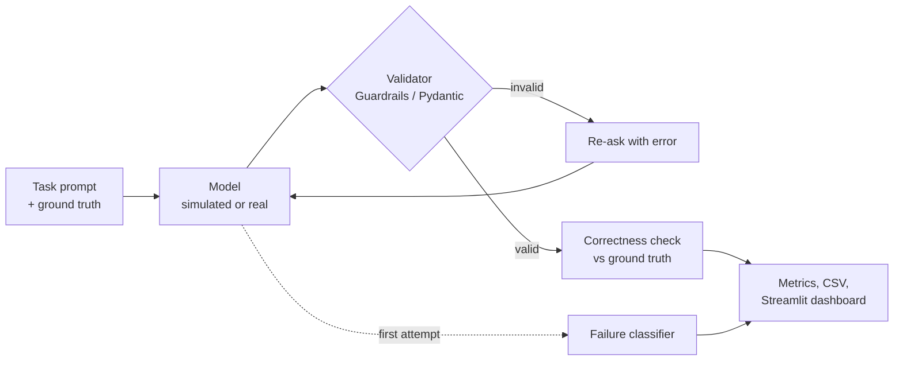

# AI Guardrails for Structured JSON

**An evaluation harness that measures whether LLM outputs match a schema, and whether the values inside are actually correct.**

[](https://github.com/ahsaan-10/AI-Guardrails-JSON/actions/workflows/tests.yml)


[](LICENSE)

[Demo walkthrough](DEMO.md) · [Methodology and metrics](TECHNICAL_NOTES.md)

---

## Why this matters

Automations that consume LLM output usually check one thing: *is it valid JSON that fits the schema?* That catches broken output, but not output that is **well-formed and wrong**. This project measures both, separately, and shows how far automatic retries can repair a model's mistakes.

## Key result

Offline run with the built-in validator, 1 retry allowed, 14 cases per model (`python run_eval.py eval --engine builtin --models strong,medium,weak`):

| Simulated model | Schema-valid on first try | Schema-valid after retry | Field accuracy | **Fully correct** |
| --- | ---: | ---: | ---: | ---: |
| Strong | 100.0% | 100.0% | 96.8% | **85.7%** |
| Medium | 57.1% | 100.0% | 100.0% | **100.0%** |
| Weak | 28.6% | 100.0% | 96.8% | **85.7%** |

**Takeaway:** retries fixed every structural failure, but the "strong" model passed validation 100% of the time while still being wrong in about 1 in 7 cases. Schema validation alone is not quality control.

> The three models are **deterministic simulations** designed to produce each failure type on purpose, so the results are reproducible offline. They are not a benchmark of commercial LLMs. Real models can be evaluated through LiteLLM (see below).

## What it does

- **Schemas:** Pydantic models for incident reports and bug reports, with enums, numeric constraints, and `extra="forbid"` to catch hallucinated fields.
- **Two validators:** Guardrails AI compared against a strict Pydantic baseline.
- **Bounded retries:** failed outputs are sent back to the model with the error, up to a set limit.
- **Failure taxonomy:** each first attempt is classified as `invalid_json`, `not_object`, `missing_field`, `extra_field`, `wrong_type`, `semantic_error`, or `valid`.
- **Correctness checks:** field-level accuracy against ground truth, separate from schema validity.
- **Dashboard and CSV:** a Streamlit app for exploring runs, plus per-case CSV export.

## How it works



## Getting started

```bash
git clone https://github.com/ahsaan-10/AI-Guardrails-JSON.git
cd AI-Guardrails-JSON
python -m venv .venv
# Windows: .venv\Scripts\activate    macOS/Linux: source .venv/bin/activate
pip install -r requirements.txt
```

| Goal | Command |
| --- | --- |
| Open the dashboard | `python -m streamlit run app.py` |
| Quick evaluation (only needs `pydantic`) | `python run_eval.py eval --engine builtin --models strong,medium,weak` |
| Evaluate with Guardrails AI | `python run_eval.py eval --engine guardrails --models strong,medium,weak` |
| Step-by-step demo | `python run_eval.py demo --engine guardrails` |
| Run the tests | `pip install pytest && pytest -q tests` |

To evaluate a real model, install `litellm`, set your provider's API key, and pass the model name. Use `--reps` to repeat runs, since a single response is not a stable measurement.

## Project structure

```text
AI-Guardrails-JSON/
├── app.py              # Streamlit dashboard
├── run_eval.py         # CLI: eval and demo commands
├── harness.py          # Retry loop, metrics aggregation, CSV export
├── engines.py          # Guardrails AI and Pydantic validators
├── failure_modes.py    # First-attempt failure classifier
├── models.py           # Simulated models and LiteLLM adapter
├── schemas.py          # Schemas, test cases, and ground truth
├── tests/              # Unit and end-to-end tests (run in CI)
├── results*.csv        # Recorded evaluation outputs
├── DEMO.md             # Guided demonstration
└── TECHNICAL_NOTES.md  # Metric definitions and validator differences
```

## Tech stack

**Python** · **Pydantic v2** · **Guardrails AI** · **Streamlit** · **LiteLLM** (optional) · **pytest** · **GitHub Actions**

## License

Released under the [MIT License](LICENSE).
